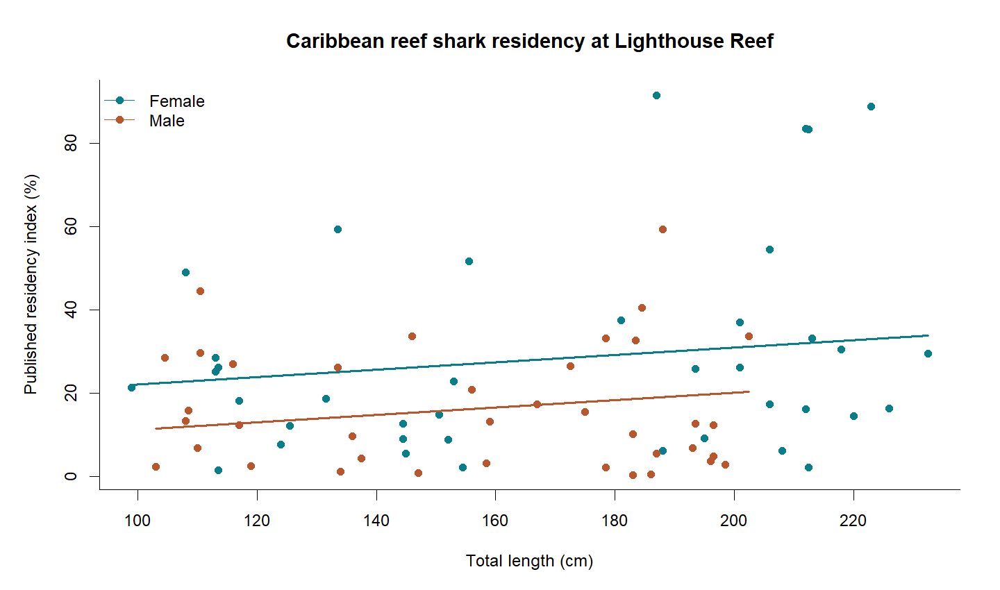
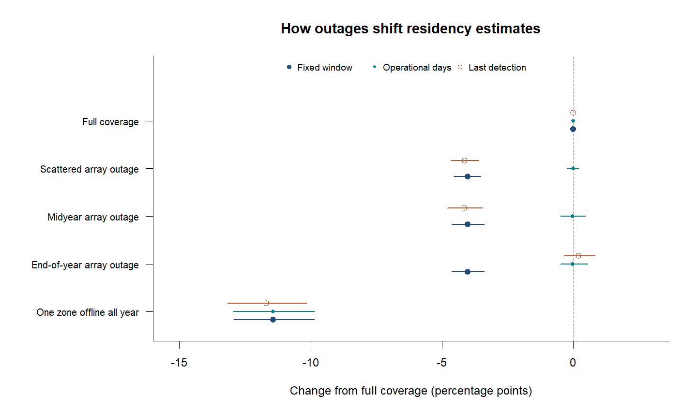
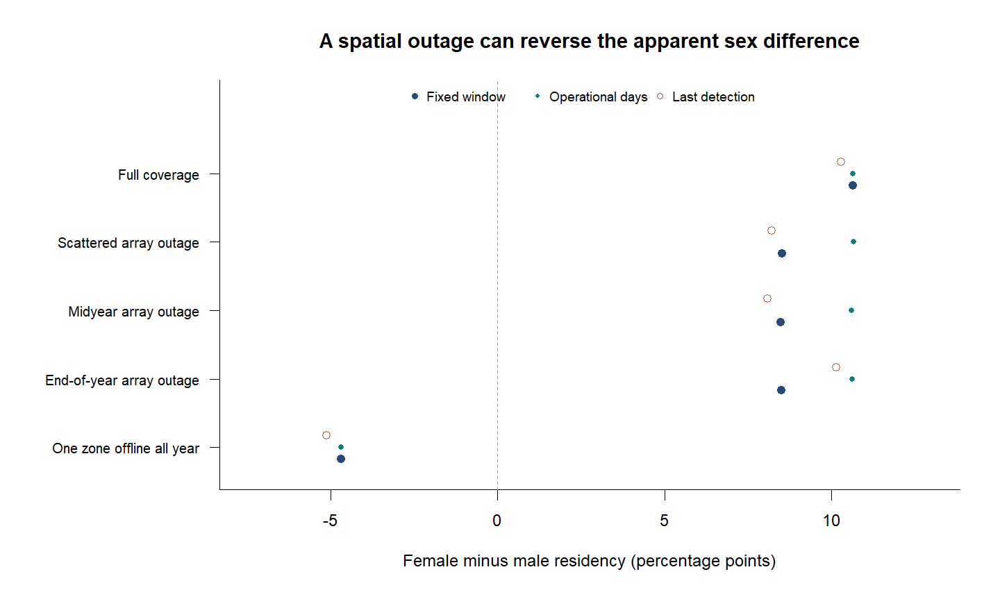

# Caribbean reef shark residency at Lighthouse Reef
## A published comparison and a receiver-outage sensitivity analysis

This project reproduces one length-adjusted residency comparison from Baremore et al. (2021) for Caribbean reef sharks (*Carcharhinus perezi*) at Lighthouse Reef Atoll, Belize. It then simulates what happens when acoustic receivers stop recording.

### Published comparison

I fit a Gaussian GLM to the 77 shark-level residency indices published in Table 1, with total length and sex as predictors. At the same length, the model estimated that males had a residency index **10.89 percentage points lower** than females (95% CI approximately **1.56 to 20.21 points lower**, p = **0.0228**). Table 2 reported a difference of 10.88 points. The small discrepancies across coefficients are consistent with fitting to rounded indices.



The study defined a detected day using at least two qualifying detections after screening for false detections. It divided detected days by an expected tracking window, with adjustments described in the paper. The second published index used the last detection as its endpoint. The project uses the printed RI values directly, including the authors' denominator adjustments. Their mean RI and RI-max round to 0.22 and 0.44, respectively. This is a table-level reproduction. The Dryad API returned a record-unavailable response, so the raw detections and actual receiver uptime could not be audited.

### Receiver outages

Across **500 paired simulated cohorts**, each with 77 sharks monitored for 365 days, I compared a fully operational array with three patterns of 73 days of complete downtime and a year-long loss of one hypothetical receiver zone.

| Outage | Change in fixed-window residency | What changed with the other denominators |
| --- | ---: | --- |
| Scattered days or one midyear outage | About −4.0 percentage points | Excluding known complete downtime removed nearly all average loss relative to full coverage. The last-detection index still fell by about 4.1 points. |
| Final 73 days | −4.0 percentage points | The last-detection index moved only +0.2 points because its denominator also shortened. |
| One zone offline all year | −11.4 percentage points | Some receivers were still active every day, so dividing by operational days left the loss unchanged. |



With full coverage, the mean simulated female-minus-male fixed-window difference was **+10.6 points**. Losing one zone changed it to **−4.7 points** because females were assumed to use that zone more often. That reversal illustrates the consequence of uneven spatial coverage under the specified assumptions. The study did not measure this outage.



### Simulation details

- Each replicate generates new presence and detection histories for 39 females and 38 males. All five outage scenarios share the same histories within a replicate.
- Individual presence probabilities come from beta distributions with sex-specific means of 0.28 and 0.16 and concentration 12. Daily presence follows a stationary two-state process with 0.7 state persistence and otherwise redraws using the individual probability.
- On a day in range, Poisson counts with mean four represent potential pings. At least two pings at an active receiver qualify as a detection. The two zones are abstract, with assumed zone-one use probabilities of 0.75 for females and 0.25 for males on any day in range.
- Fixed-window RI divides detected days by 365. Operational-days RI removes known days when the entire array was offline. Last-detection RI divides by days from deployment through the last qualifying detection and is undefined for sharks with no detections. The paired comparison uses the same sharks for a method and its no-outage counterpart.
- The outage chart shows mean paired shifts and empirical 2.5th–97.5th percentiles across simulated cohorts. The simulations assume stationary presence and outages independent of presence for full-array downtime. A correction based on operating days can behave differently if outages coincide with seasonal changes in shark presence. The output also gives errors relative to simulated presence, so baseline imperfect detection remains visible.

### Run in RStudio

Open [lighthouse-shark-residency.Rproj](lighthouse-shark-residency.Rproj). The project uses base R and ships with its input table, so it can run offline.

```r
source("run.R")        # Rebuild results and PNGs
source("show-plots.R") # Draw the three charts in the Plots pane
```

| File | Contents |
| --- | --- |
| [data/table-1.tsv](data/table-1.tsv) | Six columns transcribed from the published shark-level table |
| [results/table-2-coefficients.csv](results/table-2-coefficients.csv) | Reproduced and published coefficients side by side |
| [results/residency-by-sex.csv](results/residency-by-sex.csv) | Unadjusted group summaries |
| [results/outage-summary.csv](results/outage-summary.csv) | Summary across five scenarios and three estimators |
| [results/outage-replicates.csv](results/outage-replicates.csv) | 7,500 cohort-level results |

### Sources

Baremore, I. E., Graham, R. T., Burgess, G. H., & Castellanos, D. W. (2021). Movements and residency of Caribbean reef sharks at a remote atoll in Belize, Central America. *Royal Society Open Science, 8*, 201036. The bundled subset of Table 1 is adapted from this CC BY 4.0 article. [Paper and tables](https://pmc.ncbi.nlm.nih.gov/articles/PMC8355683/) · [Article DOI](https://doi.org/10.1098/rsos.201036) · [CC BY 4.0](https://creativecommons.org/licenses/by/4.0/)

Baremore, I. E., Graham, R. T., Burgess, G. H., & Castellanos, D. W. (2021). *Data from: Movements and residency of Caribbean reef sharks at a remote atoll in Belize, Central America* [Dataset]. Dryad. [Dryad DOI](https://doi.org/10.5061/dryad.bcc2fqz96)
